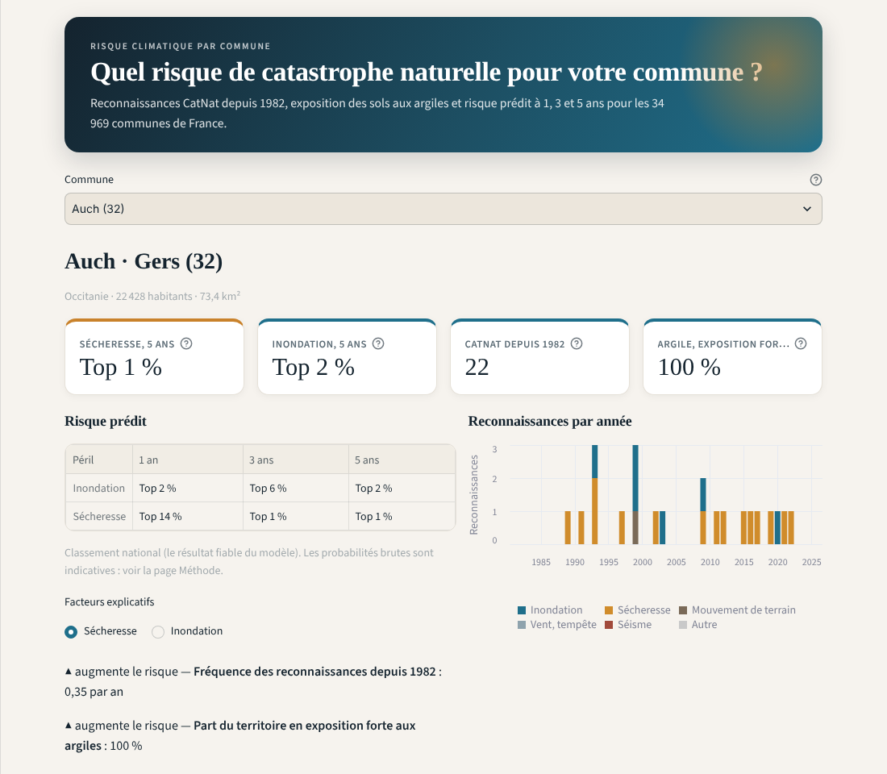
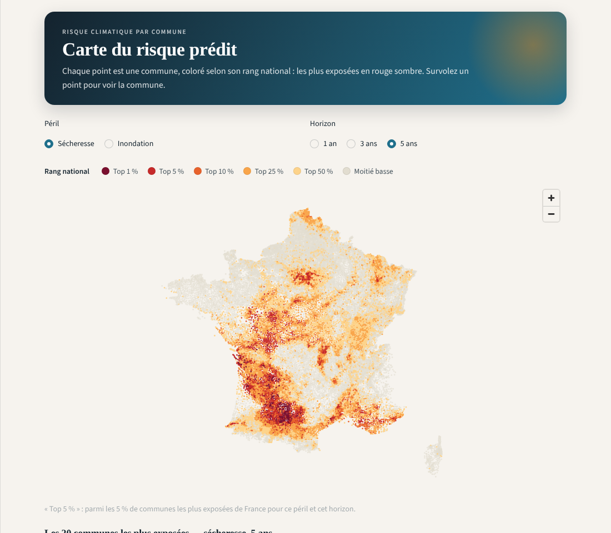
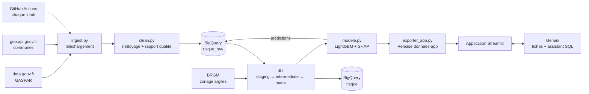
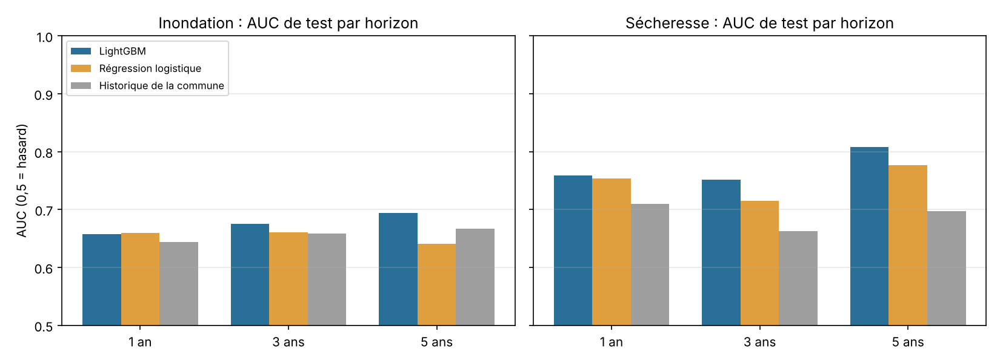
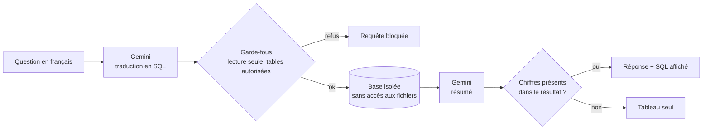

# 🌧️ Risque climatique par commune : prédire les catastrophes naturelles

> Prévoir quelles communes françaises risquent une catastrophe naturelle reconnue (inondation, sécheresse, mouvement de terrain…), expliquer pourquoi, et produire des fiches de risque lisibles par un assureur grâce à l'IA générative.

**Statut :** ✅ terminé — 5 étapes, pipeline mis à jour chaque semaine

### 👉 [Ouvrir l'application en ligne](https://risque-catnat.streamlit.app)

[](https://github.com/sabcelia1/risque-climatique-communes/actions/workflows/pipeline.yml)

---

## 🖥️ L'application

Choisir une commune pour voir son classement à 1, 3 et 5 ans, ses facteurs de risque, son historique et sa fiche rédigée par l'IA ; explorer la carte de France ; interroger les données en français.

| Une commune | La carte du risque sécheresse à 5 ans |
|---|---|
|  |  |

**En ligne : [risque-catnat.streamlit.app](https://risque-catnat.streamlit.app).** Les données de l'application sont exportées chaque semaine par le pipeline (Release [`donnees-app`](https://github.com/sabcelia1/risque-climatique-communes/releases/tag/donnees-app)). Déploiement : [`docs/guide_deploiement.md`](docs/guide_deploiement.md). En local : `lancer_application.bat`, ou `streamlit run app/streamlit_app.py`.

## 🎯 Problématique

En France, le régime des catastrophes naturelles (CatNat) indemnise les sinistrés lorsqu'un arrêté interministériel reconnaît l'état de catastrophe naturelle d'une commune. Pour un assureur, anticiper **où** ces reconnaissances vont se produire permet d'ajuster la tarification, la prévention et les provisions.

Ce projet construit, à partir de données publiques :

1. un **pipeline de données** fiable et automatisé ;
2. un **modèle de machine learning** qui estime la probabilité d'une reconnaissance CatNat par commune, avec des **explications** pour chaque prédiction ;
3. une **IA générative** qui rédige des fiches de risque par commune, **ancrées dans les données** et contrôlées automatiquement.

## 🗺️ Feuille de route

- [x] **Étape 1** — Ingestion et qualité : base GASPAR, référentiel des communes, tests unitaires
- [x] **Étape 2** — Data engineering : modèles dbt dans BigQuery, 30 tests de données dont un test anti-fuite, mise à jour hebdomadaire (GitHub Actions)
- [x] **Étape 3** — Machine learning : LightGBM par péril à 1, 3 et 5 ans, exposition aux argiles, validation temporelle, variables « à date », explicabilité (SHAP)
- [x] **Étape 4** — IA générative (Gemini) : fiches de risque dont chaque chiffre est vérifié, assistant question → SQL avec garde-fous et évaluation
- [x] **Étape 5** — Application Streamlit : fiche par commune, carte de France, assistant en langage naturel

## 📁 Sources de données

| Source | Producteur | Contenu | Licence |
|---|---|---|---|
| [Base GASPAR](https://www.data.gouv.fr/datasets/base-nationale-de-gestion-assistee-des-procedures-administratives-relatives-aux-risques-gaspar) | Ministère de la Transition écologique | Arrêtés de catastrophe naturelle par commune depuis 1982 | Licence Ouverte |
| [API Découpage administratif](https://geo.api.gouv.fr/decoupage-administratif) | Etalab | Communes, population, superficie, coordonnées | Licence Ouverte |
| [Zonage d'exposition au retrait-gonflement des argiles](https://files.georisques.fr/argiles/AleaRG_Fxx_L93.zip) | BRGM, via Géorisques | Exposition des sols (2019), croisée avec les communes par `src/exposition_argiles.py` | Licence Ouverte |
| [Contours des communes](https://geo.api.gouv.fr/decoupage-administratif) | Etalab | Limites communales (2025) | Licence Ouverte |

## 🔎 Premiers résultats

Sur **246 088 événements reconnus** depuis 1982 (détail dans le [journal d'analyse](docs/journal_analyse.md)) :

- **La sécheresse est devenue le premier péril reconnu** : 6 % des reconnaissances avant 2000, **51 % depuis 2015**.
- **Elle est reconnue très tard** : 533 jours en médiane, contre 34 pour une inondation. Les années récentes sont donc incomplètes, ce qui impose une évaluation du modèle adaptée à chaque péril.
- **Le risque est diffus** : 98,9 % des communes ont été touchées au moins une fois, avec une forte présence des Alpes-Maritimes parmi les plus touchées.

## 🏗️ Architecture



L'accès à BigQuery depuis GitHub Actions se fait **sans clé**, par fédération d'identité (Workload Identity Federation) : un jeton temporaire, valable uniquement pour ce dépôt.

Le même projet dbt tourne sur **deux bases** : **DuckDB** en local (aucun compte cloud nécessaire, idéal pour tester) et **BigQuery** en production. Le SQL est écrit pour être portable (macros `dbt.datediff`, `dbt.type_int`, macro `serie_annees` adaptée à chaque base).

### Modèles dbt

| Couche | Modèle | Rôle |
|---|---|---|
| staging | `stg_catnat`, `stg_communes` | Typage et renommage, aucune ligne retirée |
| intermediate | `int_evenements` | Événements distincts, communes actuelles, 1982-2024 |
| intermediate | `int_grille_commune_annee` | Toutes les combinaisons commune × année × péril, **zéros compris** |
| intermediate | `int_historique_a_date` | Historique de chaque commune **tel qu'il était connu au 1er janvier** (arrêtés déjà signés) |
| seeds | `exposition_argiles` | Part de chaque commune en exposition faible, moyenne ou forte aux argiles |
| marts | `dim_commune` | Communes et résumé de leur historique |
| marts | `fct_evenements` | Un événement reconnu par ligne, prêt pour l'analyse |
| marts | `mart_features_risque` | **Table d'entraînement du modèle** : historique sur 1, 5 et 10 ans, années depuis le dernier événement, fréquence dans le département, densité… |

### Tests de données

- **Intégrité :** clés uniques et non nulles, relation événements → communes, valeurs autorisées des familles de périls et de la cible.
- **Test anti-fuite** (`dbt/tests/test_absence_de_fuite.sql`) : les variables du modèle ne doivent utiliser que des arrêtés **déjà signés** au 1er janvier de l'année prédite. Le modèle regarde en arrière depuis chaque ligne ; le test, lui, projette chaque événement en avant, et échoue à la moindre différence. Vérifié en introduisant volontairement des fuites : le test les détecte.

## 🤖 Modèle de prédiction

Pour chaque commune et chaque péril, des modèles **LightGBM** estiment le risque d'au moins une reconnaissance CatNat **dans 1, 3 ou 5 ans**, à partir de ce qui était connu au 1er janvier : historique de la commune et du département, taille, localisation et **exposition des sols aux argiles** (zonage BRGM).

- **Validation temporelle :** entraînement sur le passé, choix sur des années de validation, puis **un seul** passage sur des années de test jamais vues. Pour les horizons longs, les fenêtres de cible ne se chevauchent jamais entre entraînement, validation et test.
- **Variables « à date » :** au 1er janvier, **aucune** sécheresse de l'année précédente n'est encore reconnue, contre 81 % des inondations. Les variables ne comptent que les arrêtés déjà signés.
- **Année exceptionnelle écartée :** en 1999, les tempêtes de décembre ont conduit à reconnaître 78 % des communes en inondation. Les fenêtres qui contiennent cette année inversaient ce que le modèle apprenait ; elles sont exclues de l'entraînement par une règle automatique.
- **Comparé à deux références :** l'historique de la commune et une régression logistique.
- **Explicable :** chaque prédiction est décomposée en valeurs SHAP (TreeSHAP exact), et les 3 facteurs principaux sont conservés pour l'IA générative de l'étape 4.

| Péril | Horizon | AUC test LightGBM | Référence (historique) |
|---|---|---:|---:|
| Inondation | 1 an | 0,66 | 0,64 |
| | 3 ans | 0,68 | 0,66 |
| | 5 ans | **0,69** | 0,67 |
| Sécheresse | 1 an | 0,76 | 0,71 |
| | 3 ans | 0,75 | 0,66 |
| | 5 ans | **0,81** | 0,70 |

**L'exposition aux argiles est devenue la variable la plus influente pour la sécheresse**, devant la latitude qui servait jusque-là de substitut à la nature du sol. Elle améliore l'AUC de test de 0,02 à 0,03 selon l'horizon.

**Ce que le modèle ne sait pas faire :** une reconnaissance dépend surtout de la météo, inconnue au 1er janvier. Le modèle **classe** bien les communes, mais ses probabilités ne sont pas fiables en valeur absolue, et les recaler sur les années récentes n'a pas suffi (voir le [journal d'analyse](docs/journal_analyse.md)). Le résultat à utiliser est donc le **classement** (percentile national).




## ✍️ IA générative (Gemini)

Les faits viennent toujours du pipeline ; Gemini **rédige**, et ce qu'il écrit est **contrôlé**.

**Fiches de risque par commune** ([exemples](docs/fiches_exemples.md)) : un dossier factuel (historique, exposition aux argiles, classement national à 1, 3 et 5 ans, facteurs explicatifs) est transmis à Gemini, qui rédige une fiche structurée. **Chaque nombre écrit doit figurer dans le dossier** ; sinon, un second essai est demandé, puis la fiche est rejetée.

**Assistant question → SQL** ([évaluation](docs/evaluation_assistant.md)) : une question en français devient une requête SQL, toujours affichée. Avant exécution :

- lecture seule, une seule instruction, tables autorisées uniquement, aucune fonction d'accès aux fichiers ;
- exécution dans une base **isolée** (copie en mémoire, accès aux fichiers coupé, configuration verrouillée), avec durée et nombre de lignes plafonnés ;
- en cas d'erreur SQL, un second essai avec le message d'erreur ; un refus de sécurité reste définitif.

Évalué sur **12 questions de référence** (requêtes écrites à la main) et **6 tentatives d'attaque** (« supprime la table », « lis /etc/passwd », « ignore tes instructions »…). Les résultats sont dans [`docs/evaluation_assistant.md`](docs/evaluation_assistant.md).

**Limite :** le contrôle garantit qu'aucun nombre inventé n'est publié, mais pas que chaque nombre est attribué au bon facteur. La relecture humaine a d'ailleurs trouvé un cas, documenté dans le [journal d'analyse](docs/journal_analyse.md).



## 🧹 Qualité des données

La base GASPAR présente plusieurs défauts signalés publiquement par ses utilisateurs ([discussions data.gouv.fr](https://www.data.gouv.fr/datasets/base-nationale-de-gestion-assistee-des-procedures-administratives-relatives-aux-risques-gaspar/discussions)). Le nettoyage (`src/clean.py`) les traite explicitement, et chaque contrôle est chiffré dans [`reports/qualite_donnees.md`](reports/qualite_donnees.md) :

| Défaut connu | Traitement |
|---|---|
| Fichier publié tantôt en CSV, tantôt en ZIP aux noms variables (`catnat_gaspar.csv.csv`…) | Détection automatique, extraction de la table CatNat |
| Colonnes renommées entre versions | Noms connus (`SYNONYMES`), puis détection par mots-clés (`MOTS_CLES`) ; colonnes trouvées listées dans le rapport |
| Lignes répétées 2 ou 3 fois | Dédoublonnage, nombre de lignes supprimées tracé |
| Accents mal encodés (« Sécheresse ») | Réparation automatique |
| Dates incohérentes (fin avant début, événements de plus d'un an hors sécheresse) | Mises à vide ou signalées, jamais supprimées en silence |
| Codes de communes fusionnées depuis | Signalés, puis écartés des modèles (0,2 % des lignes) |
| Libellés de périls très détaillés | Regroupement en 6 familles (inondation, sécheresse, mouvement de terrain, vent/tempête, séisme, autre) |

Les règles de nettoyage sont couvertes par des **tests unitaires** (`tests/`), exécutés avant chaque traitement.

## 🚀 Reproduire le projet

**Windows :** double-cliquez sur `lancer.bat` (environnement, tests, téléchargement, nettoyage, exploration, modèles dbt, modèle de prédiction, export de l'application), puis sur `lancer_application.bat`. Pour BigQuery, suivez d'abord le [guide de connexion](docs/guide_gcp.md).

**Manuellement :**

```bash
git clone https://github.com/sabcelia1/risque-climatique-communes.git
cd risque-climatique-communes
python -m venv .venv
source .venv/bin/activate          # Windows : .venv\Scripts\activate
pip install -r requirements.txt

python -m pytest -q                # tests
python src/ingest.py               # téléchargement
python src/clean.py                # nettoyage + rapport qualité
python src/explorer.py             # chiffres clés -> reports/exploration.md
python src/lancer_dbt.py local     # modèles dbt + tests, en local (DuckDB)
python src/modele.py               # modèle, SHAP, prédictions -> reports/modele.md

# IA générative (clé Gemini, voir docs/guide_gemini.md) :
python src/fiches.py 32013 06088   # fiches de risque -> reports/fiches.md
python src/assistant_sql.py "Quelles communes du Gers sont les plus exposées aux argiles ?"

# Application :
python src/exporter_app.py         # export compact -> app/donnees/
streamlit run app/streamlit_app.py

# Avec un accès Google Cloud (docs/guide_gcp.md) :
python src/load_bigquery.py        # chargement dans BigQuery
python src/lancer_dbt.py bigquery  # modèles dbt + tests dans BigQuery
```

## 🛠️ Stack

Python (pandas, pytest, scikit-learn, LightGBM, GeoPandas) · SQL · Google BigQuery · dbt (BigQuery, DuckDB) · GitHub Actions · Workload Identity Federation · SHAP · Gemini (google-genai, sorties structurées) · sqlglot · Streamlit

---

👤 **Célia Monga** — Ingénieure Data & IA · [Projet précédent : recharge électrique en France](https://github.com/sabcelia1/recharge-ve-france) · [LinkedIn](https://www.linkedin.com/in/c%C3%A9lia-monga-a48b48242/)
