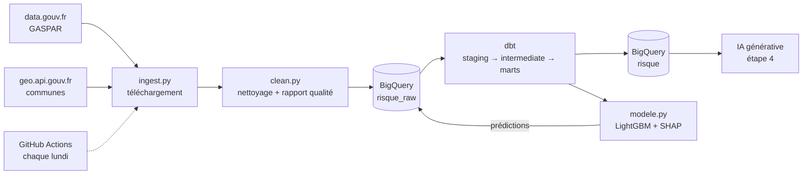
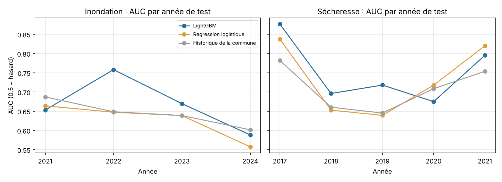
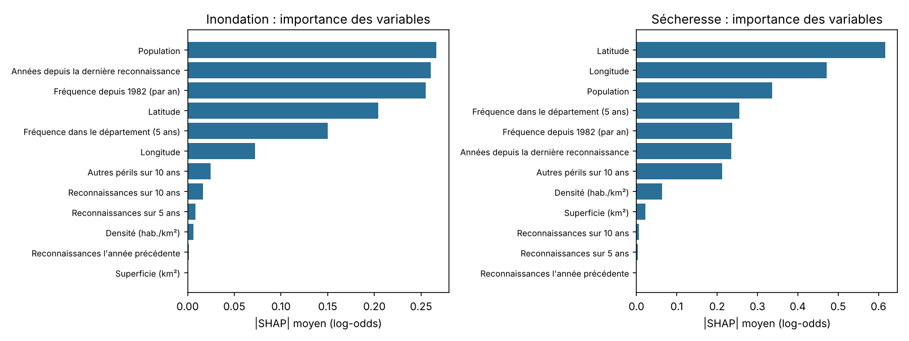

# 🌧️ Risque climatique par commune : prédire les catastrophes naturelles

> Prévoir quelles communes françaises risquent une catastrophe naturelle reconnue (inondation, sécheresse, mouvement de terrain…), expliquer pourquoi, et produire des fiches de risque lisibles par un assureur grâce à l'IA générative.

**Statut :** 🚧 en cours — étape 3/5 terminée (machine learning)

[](https://github.com/sabcelia1/risque-climatique-communes/actions/workflows/pipeline.yml)

---

## 🎯 Problématique

En France, le régime des catastrophes naturelles (CatNat) indemnise les sinistrés lorsqu'un arrêté interministériel reconnaît l'état de catastrophe naturelle d'une commune. Pour un assureur, anticiper **où** ces reconnaissances vont se produire permet d'ajuster la tarification, la prévention et les provisions.

Ce projet construit, à partir de données publiques :

1. un **pipeline de données** fiable et automatisé ;
2. un **modèle de machine learning** qui estime la probabilité d'une reconnaissance CatNat par commune, avec des **explications** pour chaque prédiction ;
3. une **IA générative** qui rédige des fiches de risque par commune, **ancrées dans les données** et contrôlées automatiquement.

## 🗺️ Feuille de route

- [x] **Étape 1** — Ingestion et qualité : base GASPAR, référentiel des communes, tests unitaires
- [x] **Étape 2** — Data engineering : modèles dbt dans BigQuery, 26 tests de données dont un test anti-fuite, mise à jour hebdomadaire (GitHub Actions)
- [x] **Étape 3** — Machine learning : LightGBM par péril, validation temporelle, variables « à date », explicabilité (SHAP)
- [ ] **Étape 4** — IA générative : fiches de risque contrôlées, assistant en langage naturel
- [ ] **Étape 5** — Application Streamlit en ligne, documentation

## 📁 Sources de données

| Source | Producteur | Contenu | Licence |
|---|---|---|---|
| [Base GASPAR](https://www.data.gouv.fr/datasets/base-nationale-de-gestion-assistee-des-procedures-administratives-relatives-aux-risques-gaspar) | Ministère de la Transition écologique | Arrêtés de catastrophe naturelle par commune depuis 1982 | Licence Ouverte |
| [API Découpage administratif](https://geo.api.gouv.fr/decoupage-administratif) | Etalab | Communes, population, superficie, coordonnées | Licence Ouverte |
| [API Géorisques](https://www.data.gouv.fr/dataservices/api-georisques) *(étape 3)* | Ministère de la Transition écologique, BRGM | Exposition aux inondations et aux argiles | Licence Ouverte |

## 🔎 Premiers résultats

Sur **246 088 événements reconnus** depuis 1982 (détail dans le [journal d'analyse](docs/journal_analyse.md)) :

- **La sécheresse est devenue le premier péril reconnu** : 6 % des reconnaissances avant 2000, **51 % depuis 2015**.
- **Elle est reconnue très tard** : 533 jours en médiane, contre 34 pour une inondation. Les années récentes sont donc incomplètes, ce qui impose une évaluation du modèle adaptée à chaque péril.
- **Le risque est diffus** : 98,9 % des communes ont été touchées au moins une fois, avec une forte présence des Alpes-Maritimes parmi les plus touchées.

## 🏗️ Architecture



L'accès à BigQuery depuis GitHub Actions se fait **sans clé**, par fédération d'identité (Workload Identity Federation) : un jeton temporaire, valable uniquement pour ce dépôt.

Le même projet dbt tourne sur **deux bases** : **DuckDB** en local (aucun compte cloud nécessaire, idéal pour tester) et **BigQuery** en production. Le SQL est écrit pour être portable (macros `dbt.datediff`, `dbt.type_int`, macro `serie_annees` adaptée à chaque base).

### Modèles dbt

| Couche | Modèle | Rôle |
|---|---|---|
| staging | `stg_catnat`, `stg_communes` | Typage et renommage, aucune ligne retirée |
| intermediate | `int_evenements` | Événements distincts, communes actuelles, 1982-2024 |
| intermediate | `int_grille_commune_annee` | Toutes les combinaisons commune × année × péril, **zéros compris** |
| intermediate | `int_historique_a_date` | Historique de chaque commune **tel qu'il était connu au 1er janvier** (arrêtés déjà signés) |
| marts | `dim_commune` | Communes et résumé de leur historique |
| marts | `fct_evenements` | Un événement reconnu par ligne, prêt pour l'analyse |
| marts | `mart_features_risque` | **Table d'entraînement du modèle** : historique sur 1, 5 et 10 ans, années depuis le dernier événement, fréquence dans le département, densité… |

### Tests de données

- **Intégrité :** clés uniques et non nulles, relation événements → communes, valeurs autorisées des familles de périls et de la cible.
- **Test anti-fuite** (`dbt/tests/test_absence_de_fuite.sql`) : les variables du modèle ne doivent utiliser que des arrêtés **déjà signés** au 1er janvier de l'année prédite. Le modèle regarde en arrière depuis chaque ligne ; le test, lui, projette chaque événement en avant, et échoue à la moindre différence. Vérifié en introduisant volontairement des fuites : le test les détecte.

## 🤖 Modèle de prédiction

Pour chaque commune, un modèle **LightGBM** par péril estime la probabilité d'une reconnaissance CatNat dans l'année, à partir de ce qui était connu au 1er janvier : historique de la commune et du département, taille, localisation.

- **Validation temporelle :** entraînement sur le passé, choix du modèle sur des années de validation, puis **un seul** passage sur des années de test jamais vues (inondation 2021-2024, sécheresse 2017-2021).
- **Variables « à date » :** au 1er janvier, **aucune** sécheresse de l'année précédente n'est encore reconnue, contre 81 % des inondations. Sans cette règle, le modèle aurait appris avec des informations indisponibles en conditions réelles.
- **Comparé à deux références :** l'historique de la commune et une régression logistique.
- **Explicable :** chaque prédiction est décomposée en valeurs SHAP (TreeSHAP exact, identique à la librairie `shap`), et les 3 facteurs principaux sont conservés pour l'IA générative de l'étape 4.

| Péril | AUC test (par année) | Top 10 % des communes jugées les plus à risque |
|---|---:|---|
| Inondation | **0,67** (référence : 0,64) | 23 % des communes touchées, **2,3 fois** mieux qu'un ciblage au hasard |
| Sécheresse | **0,75** (référence : 0,71) | 25 % des communes touchées, **2,5 fois** mieux qu'un ciblage au hasard |

**Ce que le modèle ne sait pas faire, et pourquoi :** une reconnaissance CatNat dépend surtout de la météo de l'année, que personne ne connaît au 1er janvier. Le modèle **classe** les communes à risque, mais ses probabilités brutes ne sont pas fiables en absolu (la sécheresse progresse plus vite que dans les années d'entraînement) : il est donc présenté comme un **classement** (percentile national). Les grandes sécheresses de 2018-2020 ont surtout touché des communes que l'historique ne classait pas parmi les plus exposées. Détail et pistes dans le [journal d'analyse](docs/journal_analyse.md).





## 🧹 Qualité des données

La base GASPAR présente plusieurs défauts signalés publiquement par ses utilisateurs ([discussions data.gouv.fr](https://www.data.gouv.fr/datasets/base-nationale-de-gestion-assistee-des-procedures-administratives-relatives-aux-risques-gaspar/discussions)). Le nettoyage (`src/clean.py`) les traite explicitement, et chaque contrôle est chiffré dans [`reports/qualite_donnees.md`](reports/qualite_donnees.md) :

| Défaut connu | Traitement |
|---|---|
| Fichier publié tantôt en CSV, tantôt en ZIP aux noms variables (`catnat_gaspar.csv.csv`…) | Détection automatique, extraction de la table CatNat |
| Colonnes renommées entre versions | Noms connus (`SYNONYMES`), puis détection par mots-clés (`MOTS_CLES`) ; colonnes trouvées listées dans le rapport |
| Lignes répétées 2 ou 3 fois | Dédoublonnage, nombre de lignes supprimées tracé |
| Accents mal encodés (« Sécheresse ») | Réparation automatique |
| Dates incohérentes (fin avant début, événements de plus d'un an hors sécheresse) | Mises à vide ou signalées, jamais supprimées en silence |
| Codes de communes fusionnées depuis | Signalés, puis écartés des modèles (0,2 % des lignes) |
| Libellés de périls très détaillés | Regroupement en 6 familles (inondation, sécheresse, mouvement de terrain, vent/tempête, séisme, autre) |

Les règles de nettoyage sont couvertes par des **tests unitaires** (`tests/`), exécutés avant chaque traitement.

## 🚀 Reproduire le projet

**Windows :** double-cliquez sur `lancer.bat` (environnement, tests, téléchargement, nettoyage, exploration, modèles dbt, modèle de prédiction). Pour BigQuery, suivez d'abord le [guide de connexion](docs/guide_gcp.md).

**Manuellement :**

```bash
git clone https://github.com/sabcelia1/risque-climatique-communes.git
cd risque-climatique-communes
python -m venv .venv
source .venv/bin/activate          # Windows : .venv\Scripts\activate
pip install -r requirements.txt

python -m pytest -q                # tests
python src/ingest.py               # téléchargement
python src/clean.py                # nettoyage + rapport qualité
python src/explorer.py             # chiffres clés -> reports/exploration.md
python src/lancer_dbt.py local     # modèles dbt + tests, en local (DuckDB)
python src/modele.py               # modèle, SHAP, prédictions -> reports/modele.md

# Avec un accès Google Cloud (docs/guide_gcp.md) :
python src/load_bigquery.py        # chargement dans BigQuery
python src/lancer_dbt.py bigquery  # modèles dbt + tests dans BigQuery
```

## 🛠️ Stack

Python (pandas, pytest, scikit-learn, LightGBM) · SQL · Google BigQuery · dbt (BigQuery, DuckDB) · GitHub Actions · Workload Identity Federation · scikit-learn · SHAP · Gemini · Streamlit

---

👤 **Célia Monga** — Ingénieure Data & IA · [Projet précédent : recharge électrique en France](https://github.com/sabcelia1/recharge-ve-france) · [LinkedIn](https://www.linkedin.com/in/c%C3%A9lia-monga-a48b48242/)
